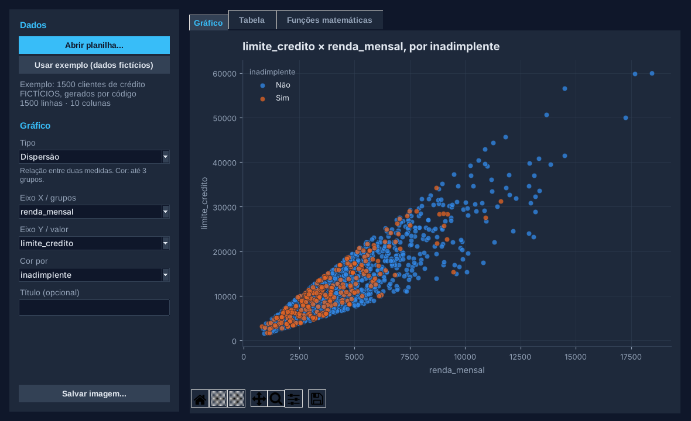
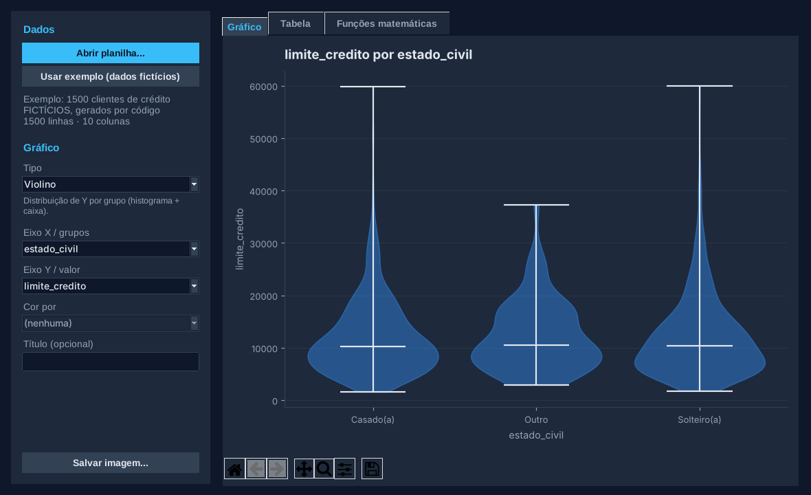
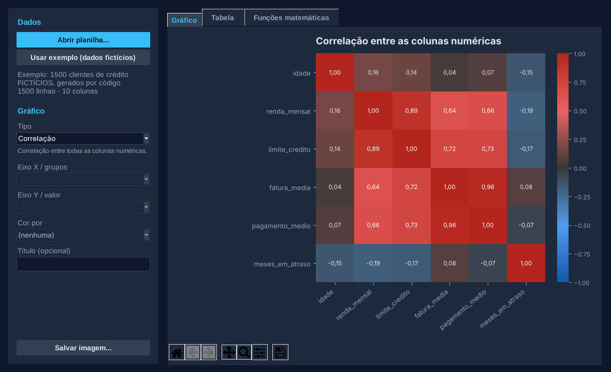
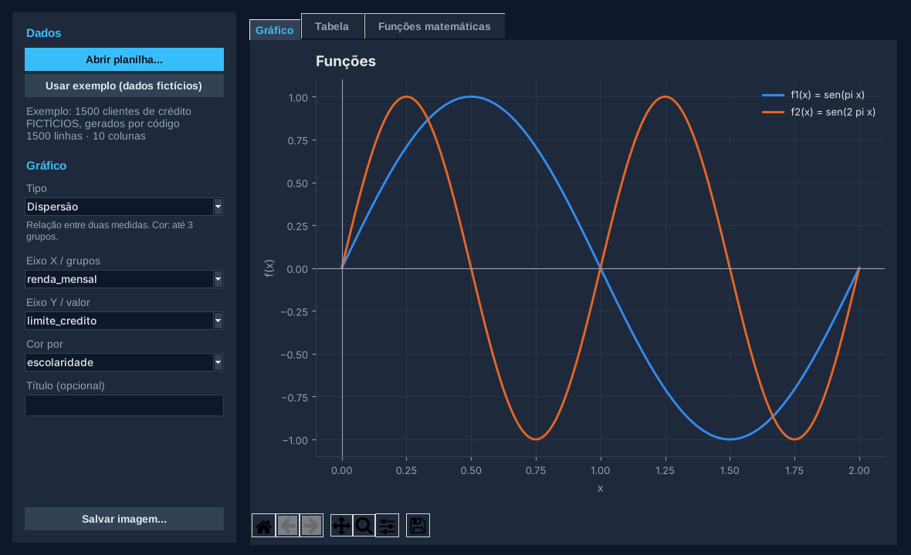

# Visualizador de Dados

Abra uma planilha (`.csv` ou `.xlsx`), escolha o tipo de gráfico e as colunas, e veja o resultado na hora, sem escrever código. Também desenha funções matemáticas como `sen(πx)` ou `x² − 3x + 2`.

| Dispersão por grupo | Violino |
|---|---|
|  |  |
| **Mapa de correlação** | **Funções matemáticas** |
|  |  |

## Funcionalidades

- **Abre planilhas** `.csv` (separador `;` ou `,`, decimal brasileiro) e `.xlsx`. Descarta sozinho colunas de índice salvas sem querer (`Unnamed: 0`).
- **Sete tipos de gráfico**:

  | Tipo | Para que serve |
  |---|---|
  | Dispersão | relação entre duas medidas, com cor por grupo |
  | Linha | média de Y para cada valor de X |
  | Histograma | distribuição de uma medida, com ou sem grupos |
  | Barras | média de Y por categoria, ou contagem |
  | Caixa (boxplot) | mediana, quartis e valores atípicos por grupo |
  | Violino | distribuição por grupo (histograma + caixa) |
  | Correlação | correlação entre todas as colunas numéricas |

- O programa mostra **só as colunas que fazem sentido** para cada tipo (números no eixo de valores, categorias nos grupos) e redesenha ao trocar qualquer opção.
- **Funções matemáticas**: até 3 funções de x num intervalo, com escrita natural (`2πx`, `x^2`, `xsen(x)`). Pontos fora do domínio, como `raiz(-1)`, viram lacunas no gráfico.
- **Tabela** com as primeiras linhas e um **resumo das colunas** (tipo, distintos, vazios, mínimo, média e máximo).
- **Salvar** o gráfico em PNG, SVG ou PDF, além de zoom e navegação pela barra do Matplotlib.
- **Exemplo embutido**: 1500 clientes de cartão de crédito **fictícios**, gerados por código (`dados.gerar_exemplo`), para experimentar sem ter uma planilha.

## Cuidados com a leitura dos gráficos

- **Cores acessíveis**: paleta categórica numa ordem fixa, validada para daltonismo contra o fundo escuro do app.
  - Na dispersão vão no máximo 3 cores (o limite em que todos os pares continuam distinguíveis), e o resto vira **"Outros"**, em cinza. Nos outros gráficos, até 8.
  - A cor acompanha a categoria: "Sim" tem sempre a mesma cor, mesmo que outras categorias sumam.
- **Correlação** em escala divergente azul ↔ vermelho, com cinza no zero e o valor escrito em cada célula.
- Linhas de 2 px, grade discreta, **um único eixo Y** e legenda sempre que houver duas ou mais séries.

## Segurança

As funções digitadas na aba "Funções matemáticas" **não são executadas como código**. O módulo `funcoes.py` converte o texto numa árvore sintática e só aceita números, `x`, constantes, operadores e funções da lista permitida. Algo como `__import__('os')` é recusado.

## Requisitos

- Python 3.9 ou mais novo, com Tkinter (já vem no instalador oficial do Windows e do macOS).
  - No Ubuntu/Debian, se faltar: `sudo apt install python3-tk`
- pandas, matplotlib, numpy e openpyxl (`requirements.txt`).

## Como usar

```bash
git clone https://github.com/thi-araujo/Data_Visualization.git
cd Data_Visualization
pip install -r requirements.txt
python visualizador.py
```

No Linux/macOS, use `python3` e `pip3`. Clique em **Usar exemplo** para experimentar, ou em **Abrir planilha...** para usar seus dados.

## Estrutura do projeto

```
Data_Visualization/
├── visualizador.py              # interface gráfica (Tkinter + Matplotlib)
├── graficos.py                  # desenho dos gráficos, paleta e regras de cor
├── dados.py                     # leitura de planilhas, tipos de coluna e dados de exemplo
├── funcoes.py                   # avaliador seguro de funções de x
├── notebooks/
│   └── Aula4_OutrosExemplos.ipynb  # notebook original do curso (2022)
├── tests/
│   └── test_visualizacao.py     # testes automatizados
└── docs/                        # capturas de tela usadas neste README
```

## Testes

```bash
python -m unittest discover -s tests -v
```

## Histórico

O repositório começou em 2022 com o notebook da **Aula 4 de um curso de visualização de dados** (Matplotlib, Seaborn e Plotly): funções seno, mapa de correlação, gráfico de violino e dispersão sobre uma planilha de clientes de crédito. A planilha não fazia parte do repositório, então o notebook não rodava fora do Colab do curso. Ele continua guardado em `notebooks/`.

Em 2026 os mesmos tipos de gráfico viraram um aplicativo que funciona com qualquer planilha, com dados de exemplo fictícios embutidos, cores acessíveis e testes.

## Autor

**Thiago Gomes Araújo**: [GitHub](https://github.com/thi-araujo) · [Portfólio](https://thi-araujo.github.io)
